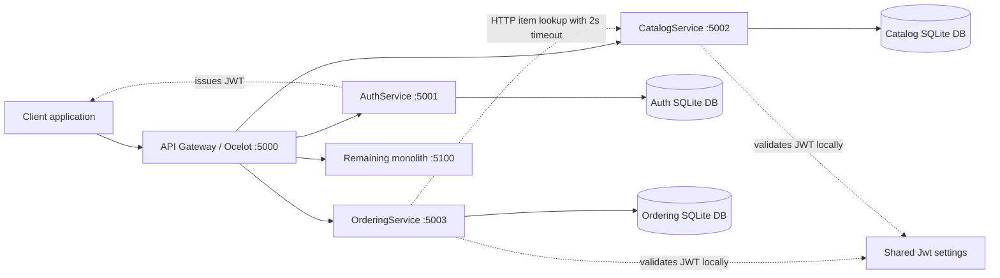

# Component diagram after OrderingService extraction

`/api/orders` is routed to OrderingService before the gateway catch-all route to the monolith. OrderingService owns the Orders table; `ProductId` is a value reference only and there is no cross-service database foreign key.
